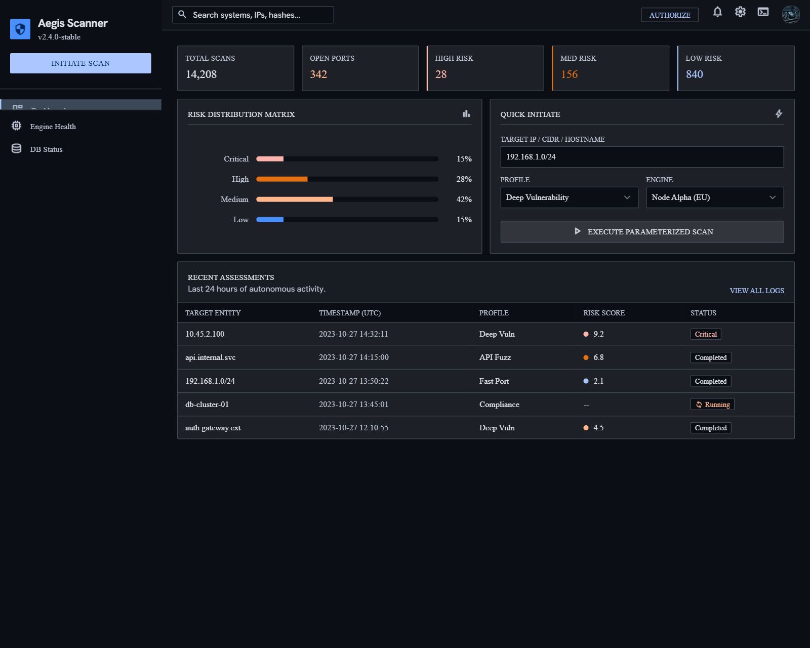
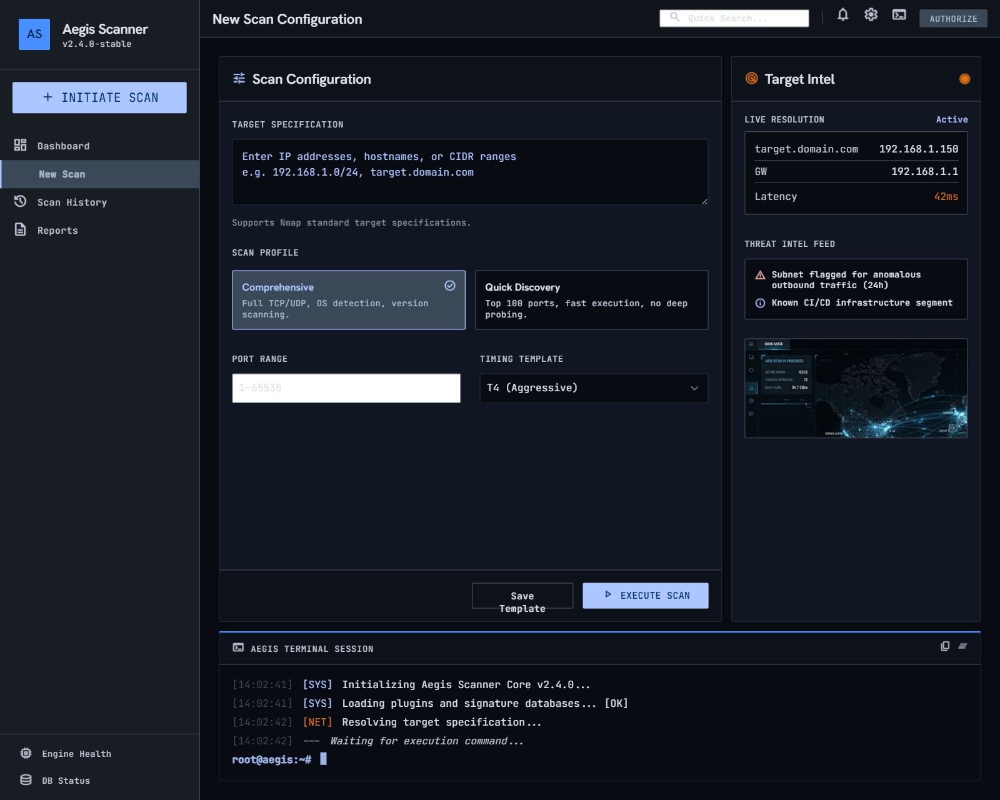
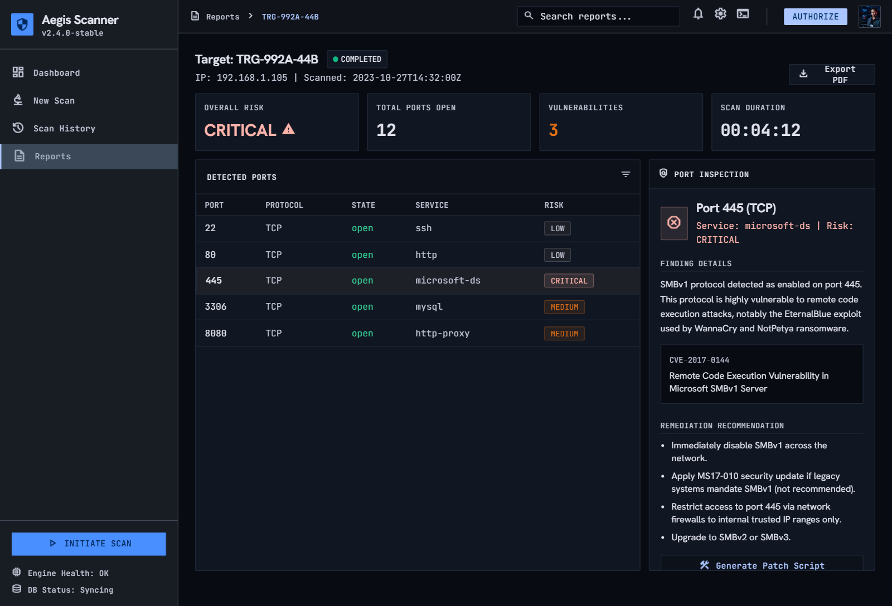
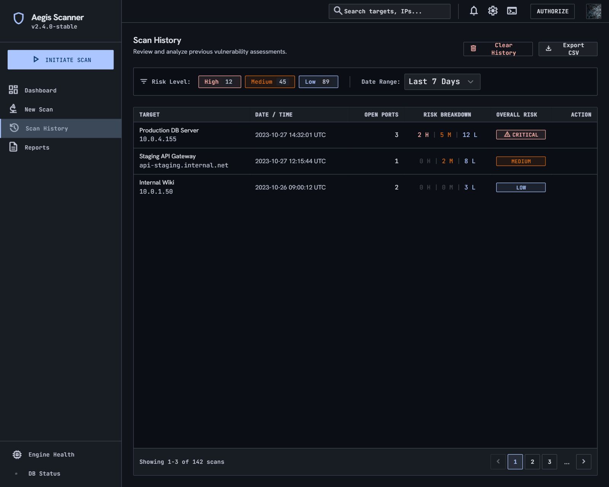

<div align="center">


# Aegis Scanner

**A Flask dashboard for authorised TCP port discovery and rule-based exposure assessment.**

[](https://github.com/deepakcybersecurity/Network-Security-Analyser/actions/workflows/ci.yml)
[](https://github.com/deepakcybersecurity/Network-Security-Analyser/actions/workflows/codeql.yml)
[](https://www.python.org/downloads/)
[](https://flask.palletsprojects.com/)
[](https://tailwindcss.com/)
[](LICENSE)

</div>

---

> [!WARNING]
> **Authorised use only.** Port scanning may be illegal, disruptive, or trigger security
> monitoring when performed without permission. Only scan systems you own or have explicit
> written authorisation to test. See [Ethical use](#ethical-use).

## Overview

Aegis wraps an Nmap TCP connect scan in a hardened Flask API and a single-page dashboard.
It validates the target before Nmap is ever invoked, rates every open port against a
transparent rule set, persists completed scans to SQLite, and exposes history, per-scan
detail, aggregate statistics, and downloadable text reports.

The project is built as a study in **defensive web application engineering** — the scanning
itself is deliberately simple, while input validation, injection resistance, error
sanitisation, rate limiting, and HTTP hardening are treated as the primary deliverable.
Each control is documented in [Security architecture](#security-architecture).

## Features

- **Target validation before execution** — regex allowlist, length bounds, option-argument
  rejection, and DNS resolution, all applied before Nmap is called.
- **Fast TCP connect scan** (`-sT -F`) over the top 100 ports, with Nmap's service
  detection. `-sT` needs no administrator privileges.
- **Transparent risk rules** — every open port is rated `HIGH`, `MEDIUM`, or `LOW` with a
  written justification. An open port is not, by itself, proof of a vulnerability.
- **Persistent history** — SQLite-backed scan records, per-port findings, and statistics
  computed from the database rather than held in memory.
- **Exportable reports** — plain-text reports generated from saved scan data.
- **Self-contained front end** — no CDN, no inline scripts, no external fonts, so the
  Content Security Policy can stay at `default-src 'self'`.

## Interface

The dashboard is a single Jinja template driven by `fetch` calls against the JSON API.
These are the design references it was built from ([`design/`](design/)):

| Dashboard | New scan |
| --- | --- |
|  |  |

| Scan results | Scan history |
| --- | --- |
|  |  |

## Architecture

```text
                  ┌──────────────────────────────────────────────┐
  Browser         │  Flask (app.py)                              │
 ┌────────┐       │  ┌────────────────────────────────────────┐  │
 │ index  │──────▶│  │ @after_request → security headers      │  │
 │ .html  │ fetch │  │ Flask-Limiter  → 10 scans/min per IP   │  │
 │ script │◀──────│  └────────────────────────────────────────┘  │
 └────────┘  JSON │        │              │                │     │
                  │        ▼              ▼                ▼     │
                  │  scanner.py    risk_analyzer.py   database.py │
                  │  validate +    rule-based rating  parameterised│
                  │  Nmap -sT -F   HIGH/MED/LOW       SQLite      │
                  └────────┼──────────────────────────────┼───────┘
                           ▼                              ▼
                     Nmap binary              instance/aegis_scanner.db
```

`POST /api/scan` validates the target, runs the scan, rates each open port, persists the
result inside a transaction, and returns the record with its `scan_id`. Every other
endpoint reads from the same database — nothing is recomputed from a live scan.

### Risk model

Ratings come from an explicit table in [`risk_analyzer.py`](risk_analyzer.py), matched by
port number first and service name second, with an unknown service falling back to `LOW`:

| Rating | Ports | Rationale |
| --- | --- | --- |
| `HIGH` | 21, 23, 445, 3306, 3389 | Cleartext legacy protocols (FTP, Telnet) or high-value services that should not face a network directly (SMB, MySQL, RDP). |
| `MEDIUM` | 22, 80, 135 | Exposed but defensible — needs hardening review (SSH keys, HTTPS migration, RPC restriction). |
| `LOW` | 443, everything else | Encrypted by design, or unrecognised and requiring manual confirmation. |

A scan's overall rating is the highest rating among its findings.

## Project structure

```text
.
├── app.py                 # Flask routes, security headers, rate limiting
├── scanner.py             # Target validation and the Nmap invocation
├── risk_analyzer.py       # Rule-based port/service risk table
├── database.py            # SQLite schema and parameterised queries
├── test_app.py            # Regression suite (no live scan, Nmap mocked)
├── requirements.txt       # Python dependencies
├── package.json           # Tailwind CSS v4 build toolchain
├── templates/
│   └── index.html         # Single-page dashboard
├── static/
│   ├── css/src.css        # Tailwind source  ← edit this
│   ├── css/style.css      # Tailwind build output (generated, committed)
│   ├── js/script.js       # Dashboard logic
│   ├── fonts/             # Self-hosted fonts (no CDN, for strict CSP)
│   └── logo.png
├── design/                # UI design references and mockups
└── instance/              # Runtime SQLite database (gitignored)
```

## Getting started

### Prerequisites

- **Python 3.12+**
- **Nmap** — [download](https://nmap.org/download.html). On Windows the default install
  path (`C:\Program Files (x86)\Nmap`) is added to `PATH` automatically at import time.
- **Node.js 20+** — only if you intend to modify the styling.

### Installation

```bash
git clone https://github.com/deepakcybersecurity/Network-Security-Analyser.git
cd Network-Security-Analyser
```

Create and activate a virtual environment:

```bash
python -m venv venv
```

```bash
source venv/bin/activate
```

On Windows, activate with `venv\Scripts\activate` instead. Then install dependencies:

```bash
pip install -r requirements.txt
```

Optionally copy the environment template and fill it in:

```bash
cp .env.example .env
```

### Running

```bash
python app.py
```

The dashboard is served at <http://127.0.0.1:5000/>. The database is created on first run
at `instance/aegis_scanner.db`.

### Configuration

Both variables are read from the environment; neither is required for local use.

| Variable | Default | Purpose |
| --- | --- | --- |
| `SECRET_KEY` | random `os.urandom(32)` per start | Flask session signing key. Set explicitly for any real deployment. |
| `FLASK_DEBUG` | `false` | Set to `true` only for local debugging — it exposes the Werkzeug interactive console. |

### Modifying the styling

`static/css/style.css` is generated by Tailwind from `static/css/src.css` and committed so
the app runs without a Node toolchain. If you change `src.css`, rebuild and commit the
output — CI verifies the two stay in sync.

```bash
npm install
```

```bash
npm run build:css
```

Use `npm run dev:css` to rebuild on change while developing.

## API

| Method | Endpoint | Purpose |
| --- | --- | --- |
| `GET` | `/` | Dashboard |
| `POST` | `/api/scan` | Scan and persist a target. Body: `{ "target": "127.0.0.1" }`. Limited to 10 req/min per IP. |
| `GET` | `/api/history` | Recent scans, newest first |
| `DELETE` | `/api/history` | Permanently clear all scans and findings |
| `GET` | `/api/scan/<scan_id>` | Saved scan metadata plus individual findings |
| `GET` | `/api/stats` | Database-backed totals by risk level |
| `GET` | `/api/scan/<scan_id>/export` | Plain-text report for a saved scan |

<details>
<summary><strong>Example</strong> — <code>POST /api/scan</code></summary>

```bash
curl -X POST http://127.0.0.1:5000/api/scan \
  -H "Content-Type: application/json" \
  -d '{"target": "127.0.0.1"}'
```

```json
{
  "target": "127.0.0.1",
  "status": "success",
  "scan_id": 1,
  "overall_risk": "MEDIUM",
  "ports": [
    {
      "port": 80,
      "protocol": "tcp",
      "state": "open",
      "service": "http",
      "risk": "MEDIUM",
      "reason": "HTTP web server is exposed. Traffic is unencrypted, meaning credentials or session tokens could be intercepted in transit. Consider migrating to HTTPS."
    }
  ]
}
```

</details>

## Testing

The suite patches `app.scan_target` and uses a temporary SQLite database, so it never
touches the network and needs no Nmap binary:

```bash
python -m unittest -v test_app.py
```

Seven tests cover request validation, malformed JSON handling, persistence across
history/details/stats/export, security headers, secret-key configuration, rate-limit
enforcement, and history deletion. CI runs them on Python 3.12 and 3.13 across Ubuntu and
Windows.

For a live end-to-end check, scan `127.0.0.1` from the dashboard. An invalid target such as
`invalid;target` is rejected with HTTP 400.

## Security architecture

| Control | Implementation |
| --- | --- |
| **Input validation** | Regex allowlist `^[a-zA-Z0-9.:-]+$`, 1–253 character bounds, leading-hyphen and leading/trailing-dot rejection, and DNS resolution — all before Nmap runs. |
| **Command injection** | Nmap invoked through `python-nmap` with fixed arguments. No `shell=True`, no shell string concatenation anywhere. |
| **SQL injection** | Every statement parameterised, with `PRAGMA foreign_keys = ON` on all connections. |
| **XSS** | DOM built with `textContent` only; risk labels validated against a client-side allowlist; CSP forbids inline and external script. |
| **Content Security Policy** | `default-src 'self'` with `object-src 'none'` and `base-uri 'self'`. Fonts and CSS are self-hosted specifically so no CDN exception is needed. |
| **HTTP hardening** | `X-Content-Type-Options: nosniff`, `X-Frame-Options: DENY`, `Referrer-Policy: strict-origin-when-cross-origin`, and `Cache-Control: no-store` on API routes. Server banner replaced with `Aegis-Scanner`. |
| **Error sanitisation** | Exceptions and Nmap failures are logged server-side via `logging`; clients receive generic JSON messages that leak no paths, versions, or stack traces. |
| **Rate limiting** | `POST /api/scan` capped at 10 requests/minute per IP via Flask-Limiter, returning sanitised JSON on 429. |
| **Debug mode** | `FLASK_DEBUG` defaults to `false`, so the Werkzeug interactive debugger is never exposed unintentionally. |
| **Data isolation** | The runtime database lives in `instance/` and is gitignored, along with `scans/` and every `.env` file. |
| **Supply chain** | Pinned dependency ranges, Dependabot updates for pip/npm/Actions, and weekly CodeQL analysis with `security-extended`. |

To report a vulnerability, see [SECURITY.md](SECURITY.md).

### Known limitations

- Flask's development server is used as-is. Any deployment beyond localhost needs a
  production WSGI server and an explicit `SECRET_KEY`.
- Rate limiting uses in-memory storage, so counters reset on restart and are not shared
  across processes. Point Flask-Limiter at Redis for a multi-worker deployment.
- There is no authentication. The app binds to `127.0.0.1` and assumes a single trusted
  local operator.
- Risk ratings are a static educational heuristic, not a vulnerability assessment. They do
  not consider version, patch level, or configuration.

## Contributing

Issues and pull requests are welcome — see [CONTRIBUTING.md](CONTRIBUTING.md) for the
development setup and expectations.

## Ethical use

Use this tool only on systems and networks you own or where you hold explicit
authorisation to perform security testing. Unauthorised port scanning is a criminal
offence in many jurisdictions, may disrupt the systems it touches, and will alert security
monitoring. You are responsible for how you use it.

## License

Released under the [MIT License](LICENSE).
